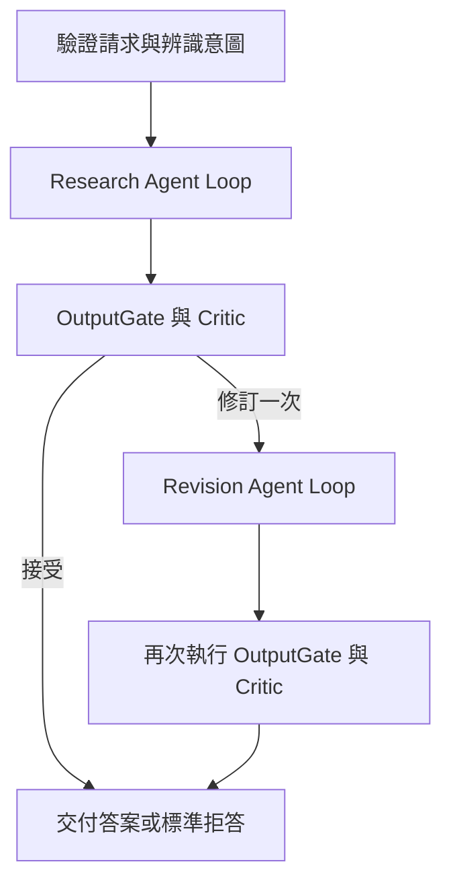

# EquityLens 研究代理架構與面試示範

EquityLens 的研究功能需要同時處理證據搜尋、回答品質與背景工作的可靠性。這次改動把 LLM 的決策範圍放在工具迴圈內，外層保留固定 DAG，讓搜尋路線可以變動，而權限、預算、品質驗收和故障恢復仍由程式控制。新引擎以 `engine: "AgentLoop"` 啟用，預設仍保留 DynamicDag。

## 開場說法

> 我原本讓 LLM 規劃 DAG，再驗證計畫並產生節點。做下來發現，研究問題真正需要變動的是搜尋工具、查詢參數和何時停止，不一定需要動態改圖。所以我保留固定 workflow，把自主性放到有預算的工具迴圈。每輪決策和工具結果都會落盤；worker 中斷後可以接手，舊 worker 也不能覆寫新結果。最後再用確定性檢查和 Critic 驗收，修訂一次仍不合格就拒答。

## 為什麼保留 DAG

DAG 適合表達穩定的依賴：先取得證據，才能寫答案；先驗收，才能交付。動態規劃 DAG 則增加了計畫 schema、節點白名單、拓撲驗證、動態合併與多輪路由的維護成本。新研究引擎不再呼叫動態 graph planner，但保留執行順序與持久化圖一致性的基本檢查。既有投資組合等工作流仍使用自己的路徑，因此沒有直接刪掉共用的 planner 和 validator。

下圖是六個邏輯階段；目前資料庫仍保留 16 個節點，原因是沿用既有 Critic 的四個 handler，避免在引擎遷移時同時改寫品質規則。



LLM 可以選工具、改查詢、安排同輪獨立搜尋和提出答案。程式決定工具是否可見、參數是否有效、預算是否足夠，以及答案能否交付。正式工具目前只有 `search_local`、`search_web` 和 `get_document_page`。沒有可信結構化數值輸入時，不開放讓 LLM 傳原始數值的計算工具。

## 最值得說明的故障案例

### 工具成功後程序中斷

先把 LLM 決策存成 `AgentLlmTurn`，再派送工具。每個工具完成就個別保存結果，整輪完成才推進 checkpoint。假設三個平行搜尋完成兩個就當機，新 worker 會讀到同一輪決策，重用已保存的兩筆結果，只補執行未保存的呼叫。

這是對已提交結果的重用。唯讀工具若已呼叫外部服務、結果卻尚未落盤，恢復時仍可能再次呼叫，不能宣稱 exactly-once。

### 舊 worker 在租約過期後回來

Heartbeat 使用獨立 DbContext 續約。每次結果寫入則在同一個資料庫交易內檢查 run、owner、lease version、到期時間與狀態，鎖住租約資料列後才提交。另一個 worker 已取得新版本時，舊 worker 的節點結果、工具結果與 checkpoint 整批拒寫。

Redis 訊息是否 ack 取決於 executor 的結果。遇到他人持有租約或執行中失去租約時，不會把訊息當成已完成而 ack。明確標示為非冪等、且已經進入 Running 的節點不自動重跑。

### 人工審批後又當機

副作用工具先保存待執行參數、canonical JSON hash、execution attempt 與 idempotency key，再暫停 run 並釋放租約。等待期間不占住 worker，也不新增 wake outbox。人類決策才產生喚醒事件。

恢復時重新驗證參數、可見性、預算與有效期限。拒絕必須附理由，理由會回到下一輪。若外部效果已發生但結果還沒落盤，接手者使用同一個 idempotency key；效果只做一次的保證來自下游工具的冪等實作。正式環境未註冊副作用工具，這條路徑以 `test_publish_note` 測試工具與故障注入驗證。

## 品質驗收的取捨

OutputGate 檢查引用存在、來源政策、答案格式與數字追溯。數字比對支援全形、千分位與萬元／億元／兆元／仟元換算。帶引用的貨幣數值無法對應來源就阻擋；其他數字超過半數無法對應也阻擋。支援財報表頭單位與 EPS 例外，股數與金額分開辨識；未明確標示的單位仍需 Critic 檢查。推導比例尚缺可信計算依據，實測出現誤擋。

Critic 負責語義上的過度主張、證據是否真的支持結論。修訂後會再次跑 Critic，不會直接把修訂稿當成功。最終驗收失敗會產生標準拒答，研究 artifact 的 status 反映失敗原因，而 runtime 可以正常結束為 Succeeded；這兩個狀態分別代表內容結果與執行結果。

實測曾找到兩種「測試全綠仍會出現」的問題：大量證據使 prompt 預算提前耗盡，以及評分器讓附帶錯誤單位的拒答通過。前者以預算內的證據視窗修正；後者增加貨幣數值檢查與標準拒答指令。這也說明 deterministic scorer、人工抽查和 fault injection 各自驗證不同事情。

## 驗證證據

| 要證明的事情 | 驗證方式 |
|---|---|
| 不會遺失未完成的工作 | Worker outcome 與 ack 測試 |
| 舊 worker 無法寫入 | 真實 PostgreSQL 的雙連線 fencing、過期拒寫與續約測試 |
| 決策和工具可恢復 | committed turn、半輪工具成功、中斷接手測試 |
| 工具真的同輪平行 | barrier 控制兩個工具同時進入執行的測試 |
| 審批不會被換參數或重複決策繞過 | hash／到期／可見性／拒絕原因測試；PostgreSQL 競爭只有一個決策和一筆 wake |
| 外部效果不重複 | 效果發生後立即取消，恢復時重用 idempotency key 的測試 |
| 新路徑不用動態 planner | 注入一個被呼叫就失敗的 planner，完整 workflow 仍可完成 |
| 實際回答品質和延遲 | 同一公開 corpus、同一題庫、同設定的 A/B，保留原始回答 |

`c953970` 的驗證為 942 項後端測試與 70 項 eval 測試通過。完整 PostgreSQL 測試已啟用；不是把整合測試 skip 後報全綠。A/B 數字、每題退步、provider usage 和預設切換門檻見[實測報告](../eval-verification/2026-11-02-agent-loop-ab/README.md)。

## 三分鐘示範

先顯示一個 research run：固定節點外框、逐輪 LLM action、工具參數與 guard、引用和最終答案。再跑一個故障注入測試，解釋結果如何恢復。最後打開 A/B 報告，說明仍未達到的門檻。

已啟動 API 時，可在另一個終端執行：

```bash
# Token 從自己的本機測試帳號取得，不放進命令歷史或投影片。
export EQUITYLENS_BASE_URL=http://127.0.0.1:5535
read -rsp 'JWT: ' EQUITYLENS_TOKEN
export EQUITYLENS_TOKEN
python3 scripts/demo-research-agent.py
```

可靠性示範不需要外部模型或金鑰：

```bash
dotnet test tests/EquityLens.Api.Tests/EquityLens.Api.Tests.csproj \
  --filter 'FullyQualifiedName~ToolApprovalTests.CrashAfterExternalEffect'
dotnet test tests/EquityLens.Api.Tests/EquityLens.Api.Tests.csproj \
  --filter 'FullyQualifiedName~ResearchAgentLoopTests.CrashWithinTurn'
```

網路不穩時，直接顯示保存的 `responses.jsonl`、`report.md` 與測試結果。不要臨場把資料不足的回答包裝成正確答案。隔離環境與重現設定記錄在[進度檔](research-agent-runtime-progress.md)及[實驗 manifest](../eval-verification/2026-11-02-agent-loop-ab/experiment-manifest.json)。

## 面試追問

**為什麼不直接用一個 Agent 做完全部？** 搜尋需要彈性，但權限、預算、審批與提交結果需要可預測的規則。固定外框讓這些規則可獨立測試，也保留可查詢的執行狀態。

**這是 Microsoft Agent Framework 的 runtime 嗎？** 不是。這是自己的 persisted DAG runner 與有界工具迴圈；既有 agent 透過介面接入。沒有把框架名稱當作可靠性的證明。

**為什麼不保證 exactly-once？** 資料庫交易無法和任意外部 API 共用提交點。系統保證已保存的結果不重做；外部副作用需要下游接受並實作 idempotency key。

**通過率提高就能上線嗎？** 還要看原本通過題是否退步、幻覺與來源政策、p95 延遲及完整 provider 成本。正式驗收限定台積電與鴻海的 8 題 verified 開發集，是反覆使用的題目，單次結果不能推論全面優於舊引擎；還需要未參與調整的題目與多次重跑。

**還沒完成什麼？** 風險觸發的結果人工審閱、整個 workflow 的共同成本硬上限、可信結構化數值工具，以及把既有四個 Critic 節點合併為單一品質節點。這些與目前已驗證的工具審批、節點預算和故障恢復分開列管。
