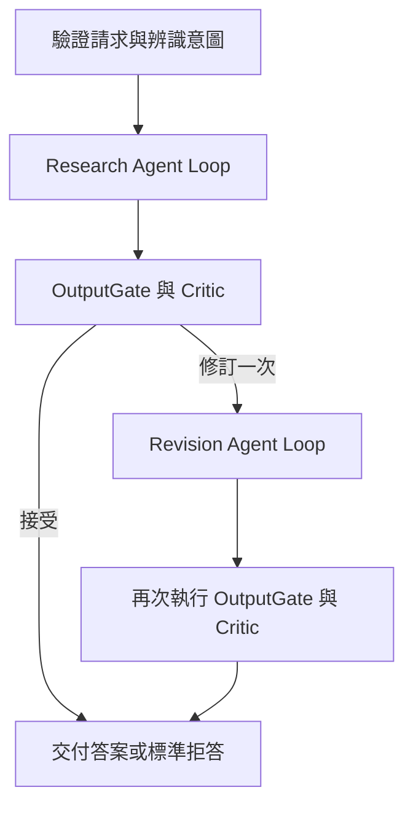

# EquityLens 研究代理架構與面試示範

EquityLens 的研究功能需要同時處理證據搜尋、回答品質與背景工作的可靠性。這次改動把 LLM 的決策範圍放在工具迴圈內，外層保留固定 DAG，讓搜尋路線可以變動，而權限、預算、品質驗收和故障恢復仍由程式控制。正式環境已於 2026-11-03 啟用 AgentLoop 預設；仍可明確指定 `engine: "DynamicDag"` 使用舊引擎，未設定環境的程式 fallback 不變。部署與備份見 [部署紀錄](research-agent-runtime-deployment.md)。

## 開場說法

> 我原本讓 LLM 規劃 DAG，再驗證計畫並產生節點。做下來發現，研究問題真正需要變動的是搜尋工具、查詢參數和何時停止，不一定需要動態改圖。所以我保留固定 workflow，把自主性放到有預算的工具迴圈。每輪決策和工具結果都會落盤；worker 中斷後可以接手，舊 worker 也不能覆寫新結果。最後再用確定性檢查和 Critic 驗收，修訂一次仍不合格就拒答。

## 為什麼保留 DAG

DAG 適合表達穩定的依賴：先取得證據，才能寫答案；先驗收，才能交付。動態規劃 DAG 則增加了計畫 schema、節點白名單、拓撲驗證、動態合併與多輪路由的維護成本。新研究引擎不再呼叫動態 graph planner，但保留執行順序與持久化圖一致性的基本檢查。既有投資組合等工作流仍使用自己的路徑，因此沒有直接刪掉共用的 planner 和 validator。

下圖是六個邏輯階段；目前資料庫仍保留 16 個節點，原因是沿用既有 Critic 的四個 handler，避免在引擎遷移時同時改寫品質規則。



LLM 可以選工具、改查詢、安排同輪獨立搜尋和提出答案。程式決定工具是否可見、參數是否有效、預算是否足夠，以及答案能否交付。正式 Research Agent Loop 工具目前只有 `search_local`、`search_web` 和 `get_document_page`。沒有可信結構化數值輸入時，不開放讓 LLM 傳原始數值的計算工具。

## 最值得說明的故障案例

### 工具成功後程序中斷

先把 LLM 決策存成 `AgentLlmTurn`，再派送工具。每個工具完成就個別保存結果，整輪完成才推進 checkpoint。假設三個平行搜尋完成兩個就當機，新 worker 會讀到同一輪決策，重用已保存的兩筆結果，只補執行未保存的呼叫。

這是對已提交結果的重用。唯讀工具若已呼叫外部服務、結果卻尚未落盤，恢復時仍可能再次呼叫，不能宣稱 exactly-once。

### 舊 worker 在租約過期後回來

Heartbeat 使用獨立 DbContext 續約。每次結果寫入則在同一個資料庫交易內檢查 run、owner、lease version、到期時間與狀態，鎖住租約資料列後才提交。另一個 worker 已取得新版本時，舊 worker 的節點結果、工具結果與 checkpoint 整批拒寫。

Redis 訊息是否 ack 取決於 executor 的結果。遇到他人持有租約或執行中失去租約時，不會把訊息當成已完成而 ack。明確標示為非冪等、且已經進入 Running 的節點不自動重跑。

### 人工審批後又當機

副作用工具先保存待執行參數、canonical JSON hash、execution attempt 與 idempotency key，再暫停 run 並釋放租約。等待期間不占住 worker，也不新增 wake outbox。人類決策才產生喚醒事件。

恢復時重新驗證參數、可見性、預算與有效期限。拒絕必須附理由，理由會回到下一輪。若外部效果已發生但結果還沒落盤，接手者使用同一個 idempotency key；效果只做一次的保證來自下游工具的冪等實作。正式環境未註冊副作用工具，這條路徑以 `test_publish_note` 測試工具與故障注入驗證。

## 品質驗收的取捨

OutputGate 檢查引用存在、來源政策、答案格式與數字追溯。數字比對支援全形、千分位與萬元／億元／兆元／仟元換算。帶引用的貨幣數值無法對應來源就阻擋；其他數字超過半數無法對應也阻擋。支援財報表頭單位與 EPS 例外，股數與金額分開辨識；未明確標示的單位仍需 Critic 檢查。對明示的百分比除法，先以同句引用精確核對運算元與單位，再由程式重算；錯誤算式、零分母及不同維度會阻擋。尚未提供通用結構化 metric ledger 或成長率工具。

Critic 負責語義上的過度主張、證據是否真的支持結論。修訂後會再次跑 Critic，不會直接把修訂稿當成功。最終驗收失敗會產生標準拒答，研究 artifact 的 status 反映失敗原因，而 runtime 可以正常結束為 Succeeded；這兩個狀態分別代表內容結果與執行結果。

實測曾找到兩種「測試全綠仍會出現」的問題：大量證據使 prompt 預算提前耗盡，以及評分器讓附帶錯誤單位的拒答通過。前者以預算內的證據視窗修正；後者增加貨幣數值檢查與標準拒答指令。這也說明 deterministic scorer、人工抽查和 fault injection 各自驗證不同事情。

## 驗證證據

| 要證明的事情 | 驗證方式 |
|---|---|
| 不會遺失未完成的工作 | Worker outcome 與 ack 測試 |
| 舊 worker 無法寫入 | 真實 PostgreSQL 的雙連線 fencing、過期拒寫與續約測試 |
| 決策和工具可恢復 | committed turn、半輪工具成功、中斷接手測試 |
| 工具真的同輪平行 | barrier 控制兩個工具同時進入執行的測試 |
| 審批不會被換參數或重複決策繞過 | hash／到期／可見性／拒絕原因測試；PostgreSQL 競爭只有一個決策和一筆 wake |
| 外部效果不重複 | 效果發生後立即取消，恢復時重用 idempotency key 的測試 |
| 新路徑不用動態 planner | 注入一個被呼叫就失敗的 planner，完整 workflow 仍可完成 |
| 實際回答品質和延遲 | 同一公開 corpus、同一題庫、同設定的 A/B，保留原始回答 |

後端 `53b5db1` 通過 958 項測試；同步 Claude `379022b` 後，eval harness 通過 75 項測試。完整 PostgreSQL 測試已啟用；不是把整合測試 skip 後報全綠。A/B 數字、每題退步、provider usage 和預設切換門檻見[實測報告](../eval-verification/2026-11-02-agent-loop-ab/README.md)。

## 三分鐘示範

先顯示一個 research run：固定節點外框、逐輪 LLM action、工具參數與 guard、引用和最終答案。再跑一個故障注入測試，解釋結果如何恢復。最後打開 A/B 報告，說明最新兩輪達到比較門檻，但開發集僅 8 題、政策題仍失敗且不是獨立 holdout。

優先準備離線備案，直接重播已保存的真實 API 結果；畫面會標示 OFFLINE REPLAY、後端 commit、執行時間、原評分與工具統計，不重新呼叫模型或需要 JWT：

```bash
python3 scripts/demo-research-agent.py \
  --replay docs/eval-verification/2026-11-02-agent-loop-ab/agent-loop-unit-verification/responses.jsonl \
  --case 2330-eps-2025

# 同一份紀錄也能示範政策題的 FAIL 原因，並非只展示成功答案。
python3 scripts/demo-research-agent.py \
  --replay docs/eval-verification/2026-11-02-agent-loop-ab/agent-loop-unit-verification/responses.jsonl \
  --case 2330-no-guaranteed-profit
```

需要展開來源摘錄時加 `--show-quotes`。離線檔只保留執行統計，不能冒充逐輪即時動作或完整後端 trace；要展示完整 LLM turn，使用 live 模式或已保存於隔離資料庫的 detail API。

已啟動 API 時，可在另一個終端執行：

```bash
# Token 從自己的本機測試帳號取得，不放進命令歷史或投影片。
export EQUITYLENS_BASE_URL=http://127.0.0.1:5535
read -rsp 'JWT: ' EQUITYLENS_TOKEN
export EQUITYLENS_TOKEN
python3 scripts/demo-research-agent.py
```

可靠性示範不需要外部模型或金鑰：

```bash
dotnet test tests/EquityLens.Api.Tests/EquityLens.Api.Tests.csproj \
  --filter 'FullyQualifiedName~ToolApprovalTests.CrashAfterExternalEffect'
dotnet test tests/EquityLens.Api.Tests/EquityLens.Api.Tests.csproj \
  --filter 'FullyQualifiedName~ResearchAgentLoopTests.CrashWithinTurn'
```

網路不穩時，直接顯示保存的 `responses.jsonl`、`report.md` 與測試結果。不要臨場把資料不足的回答包裝成正確答案。隔離環境與重現設定記錄在[進度檔](research-agent-runtime-progress.md)及[實驗 manifest](../eval-verification/2026-11-02-agent-loop-ab/experiment-manifest.json)。

## 面試追問

**為什麼不直接用一個 Agent 做完全部？** 搜尋需要彈性，但權限、預算、審批與提交結果需要可預測的規則。固定外框讓這些規則可獨立測試，也保留可查詢的執行狀態。

**這是 Microsoft Agent Framework 的 runtime 嗎？** 不是。這是自己的 persisted DAG runner 與有界工具迴圈；既有 agent 透過介面接入。沒有把框架名稱當作可靠性的證明。

**為什麼不保證 exactly-once？** 資料庫交易無法和任意外部 API 共用提交點。系統保證已保存的結果不重做；外部副作用需要下游接受並實作 idempotency key。

**通過率提高就能上線嗎？** 還要看原本通過題是否退步、幻覺與來源政策、p95 延遲及完整 provider 成本。正式驗收限定台積電與鴻海的 8 題 verified 開發集，是反覆使用的題目，單次結果不能推論全面優於舊引擎；還需要未參與調整的題目與多次重跑。

**還沒完成什麼？** 風險觸發的結果人工審閱、整個 workflow 的共同成本硬上限、財報研究的通用結構化數值工具，以及把既有四個 Critic 節點合併為單一品質節點。投組功能分支已有從授權資料庫快照計算的唯讀情境工具，但它不是 Research Agent Loop 的財報計算工具，已於 2026-11-03 02:12 經使用者授權部署正式環境。

## 原有驗收資料

題目與標準答案沿用 [2026-10-01 原件核實](../eval-verification/2026-10-01/report.md)，沒有為新引擎另編答案。原有 [2026-11-02 檢索實驗](../eval-verification/2026-11-02-retrieval-policy/README.md) 的 ask 模式、reranker 設定與本次 investigation 不同，分數不可直接相比。該報告已記錄政策評分 KI-004；本次仍沿用原 scorer，不因固定風險說明沒有引用而放寬通過條件。

最新 `53b5db1` 重跑：原 scorer 下 v1 6/8、v4 7/8，p95 10.993s 對 11.486s；前一輪 `c4e0d85` 也是 6/8 對 7/8。政策題因固定風險說明無引用而 FAIL，未改 scorer。這是重複使用同一開發集的兩輪結果，尚不宣稱普遍勝出。其後經使用者授權，正式環境已於 2026-11-03 切換 AgentLoop；歷史實驗中的「保留 v1 預設」是當時決策。

另以已核實 EPS 設計獨立錯誤前提補充題，兩引擎均能指出基本／稀釋值混淆；不併入 8 題分母。人工抽查仍找到舊引擎附帶計算基礎的千倍單位不一致，規則 PASS 不能代替整份回答的人工品質判斷。不存在業務的拒答題仍未補齊。


## 投組情境展示：合成行情驗收與正式部署

此段是 `feat/portfolio-scenario-analysis` 的增補展示，實作 commit `d2a0b71`；已合併 main `d8af5ef`，於 2026-11-03 02:12 經使用者授權部署正式網站。以下保存的展示資料仍為隔離合成行情，不能因已部署就解讀為正式行情回測。完整證據見[投組驗收報告](../eval-verification/2026-11-03-portfolio-scenarios/README.md)。後端完整套件 977 項、前端 124 項通過；數字屬此功能分支，不取代上方研究引擎歷史版本的測試紀錄。

1. 開啟保存的[比較畫面](../eval-verification/2026-11-03-portfolio-scenarios/comparison-detail.png)，先說明行情是合成資料。國巨原權重 50%，比較減到 30%／20%，減碼金額轉現金，其他股數不變。
2. 說明分工：LLM 抽取情境參數；固定節點從已授權投組取得價格、股數與現金，先保存快照，再由程式計算。模型不能自行填入一組風險數字當工具證據。
3. 展示風險占比與績效貢獻的差異。風險占比可為負或超過 100%，反映共變異數抵減，不是配置權重。情境與舊診斷的計算口徑不同，差異必須相對同表基準。
4. 展示修正追問的子報告 `8154ef2d-4bee-4474-a359-0b88c81c2e45`，保留父版本、同投組與一年期間。這是新診斷，不會改寫原報告或持倉；報告發布仍走既有批准流程。

離線數學驗證：

```bash
python3 docs/eval-verification/2026-11-03-portfolio-scenarios/verify_snapshot.py
```

預期三列 PASS。這個 Python 程式獨立用保存價格重算波動率、VaR、ES、假設回撤，並核對現金與其他股數；不是市場回測。缺少 120 筆共同報酬時只顯示配置，模型品質仍為 Unvalidated。實際行情回歸、VaR 覆蓋率回測與未參與調整的問句，仍是後續驗收事項。
