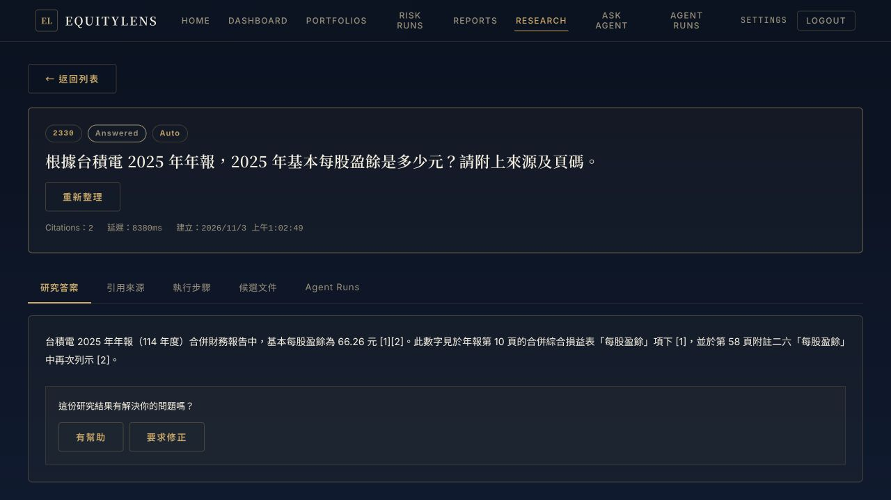
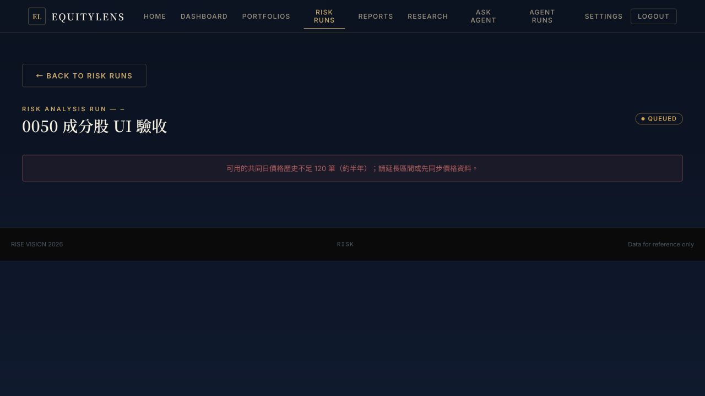
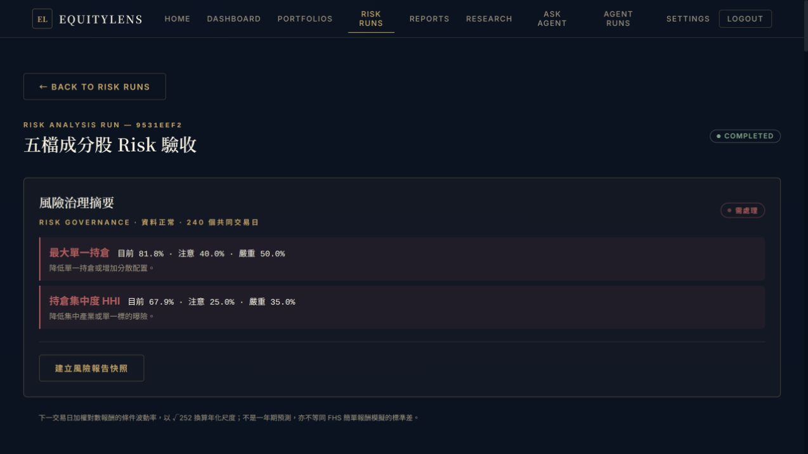
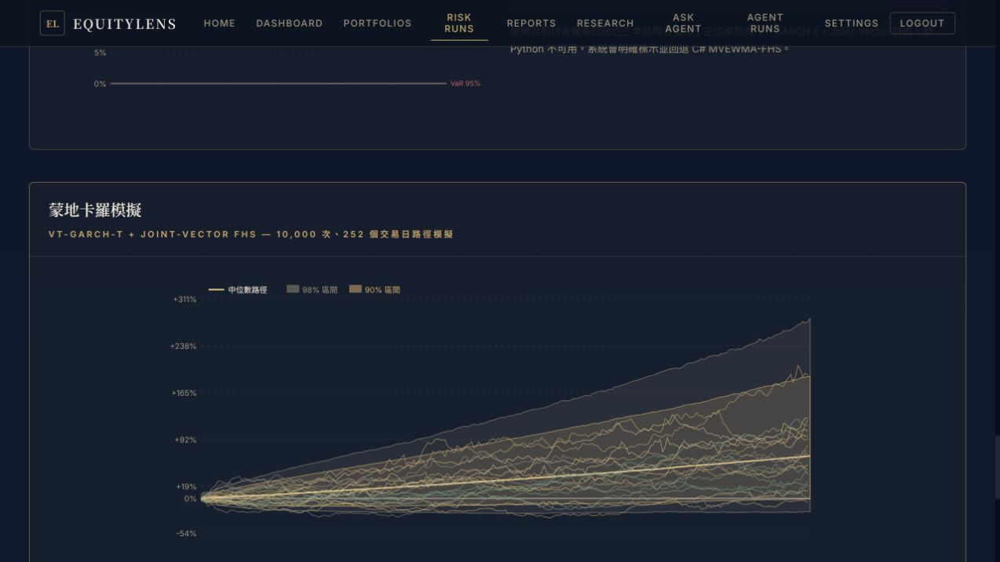

# 正式站瀏覽器驗收 — 2026-11-03

在 `https://equitylens.pages.dev/` 透過瀏覽器註冊獨立測試帳號，建立「0050 成分股 UI 驗收」。所有交易均為帳務模擬，沒有券商下單。未更動既有帳號持倉。帳號密碼不存入版本控制。

## 研究：通過

- UI 提問：根據台積電 2025 年年報，2025 年基本每股盈餘是多少元？請附上來源及頁碼。
- Agent run：`d3477310-0770-4819-9850-6c2b09af3508`，ResearchAgent / Succeeded，8.4 秒。
- Research run：`51f6a883-4e02-47a4-b886-58ab3e98c53b`，Answered，8380ms。
- 答案為基本 EPS 66.26 元；兩項引用分別為年報第 10、58 頁，已在引用頁核對原文。
- 單題 UI smoke，不代表重新完成八題 eval。

## 50 檔組合：建立成功；Risk Run：資料門檻阻擋

- Portfolio：`cd87a30e-9d4c-424e-bfac-47d98833aca9`。
- 名單來源：[元大 0050 官方持股比重](https://www.yuantaetfs.com/product/detail/0050/ratio)，頁面日期 2026-11-02，展開 More 後共 50 檔。
- 各檔模擬股數為官方股數除以 1,000,000 向下取整（至少 1 股），交易日期 2026-11-02，採系統收盤價。未納入基金現金與期貨，不能視為精確複製 0050。
- UI 最終顯示 50 檔，約 240 萬元；台積電權重 57.94%。持股數量逐筆核對。
- 從 Risk Runs 選取該組合，建立請求遭 `risk.insufficient_prices` 拒絕，沒有成功的風險結果。
- 正式 DB 唯讀核對：50 檔共同日線為 **241 天**（2025-11-03 至 2026-11-02），該組合 `risk_calculation_run` 筆數 **0**。
- 唯一少於 352 筆的成分股為 **6446 藥華藥（241 筆）**。實際建立路徑使用 `PreparePortfolioRiskBacktestInputAsync`，要求 252 + 100 = **352** 個共同交易日。先補齊可查證的歷史價格，再重跑；不可填造資料或默默移除成分股。

## 發現的待修問題

1. **連續新增持股競態**：`handleAddStock` 在刷新完成前先關閉表單，使用者可開始下一筆；稍後 `selectHolding` 會覆寫新的股票選擇。實測一次把預定中華電 93 股寫為華碩 93 股。測試帳已用同日同價的模擬賣出抵銷，再正確新增中華電；最終華碩 16 股、中華電 93 股。保留校正紀錄，沒有刪除資料。後續操作等待新增流程結束並在送出前核對標的。
2. **風險錯誤文案錯誤**：實際要求 352 天，UI 把 `risk.insufficient_prices` 固定轉成不足 120 筆。
3. **風險狀態誤導**：建立請求失敗、run 尚不存在，仍顯示 QUEUED。應顯示建立失敗及真實門檻。

本次僅執行 UI 驗收與唯讀診斷，尚未修補上述程式問題或部署新版本。正式 AgentLoop 預設維持啟用。

## 使用者指定五檔再測：Risk 與 Monte Carlo 通過

另建「五檔成分股 Risk 驗收」，Portfolio `b8790cf8-b132-4330-b53f-cc89e78dfbf3`，保留原 50 檔組合。沿用原測試的股數與 2026-11-02 收盤價，並非等權配置。

| 股票 | 股數 | 結果頁權重 |
|---|---:|---:|
| 台積電 2330 | 596 | 81.77% |
| 聯發科 2454 | 35 | 8.18% |
| 台達電 2308 | 47 | 3.75% |
| 富邦金 2881 | 203 | 1.91% |
| 鴻海 2317 | 297 | 4.39% |

透過正式 UI 進入 Risk Runs，顯示 COMPLETED。正式 DB 唯讀核對兩筆持久化結果皆 Completed，selected model 皆為 VT-GARCH-t + Joint-Vector FHS，fallback reason 為空：

- risk：`9531eef2-4a74-44b2-bd38-ed3c6b7f658f`。
- monte-carlo：`89b1ed99-254d-4ac8-a7f8-8376b2defc4e`。
- 10,000 次模擬，lookback 252 個日報酬，資料日 2026-11-02，Fit Health Healthy。
- 1 日 VaR 95% **-2.51%**（約 -42,700 元），ES 95% **-3.51%**，VaR 99% **-4.06%**，ES 99% **-5.15%**。
- 條件波動率年化 **28.70%**；歷史最大回撤 **-30.03%**。
- 已實際捲動並看到 Monte Carlo 路徑圖完成載入。

這次完成的是執行與畫面 smoke；Risk Quality 仍為 Unvalidated，未宣稱模型統計驗證通過。UI 的歷史模擬法與正式模型對照列顯示相同數字，壓力測試與回測區塊仍未見完整結果，應另查呈現與載入邏輯，不列為本次通過項目。台積電高度集中，因此不能把上述數字當成等權五檔或完整 0050 的風險。

