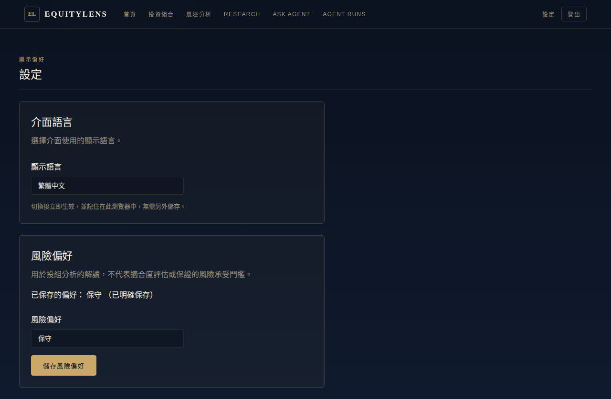
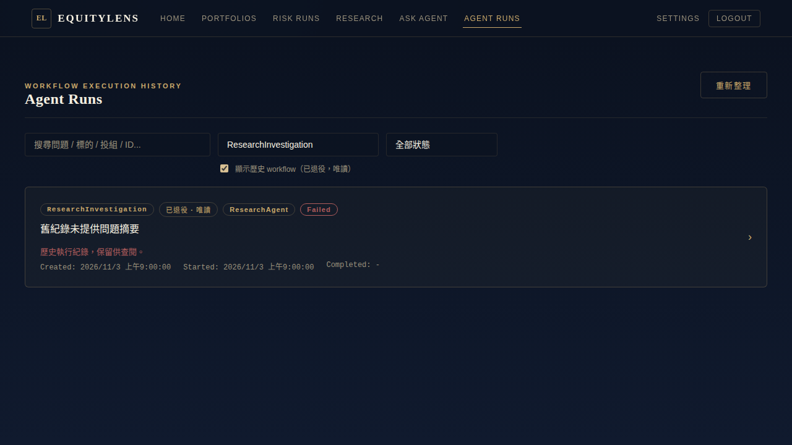
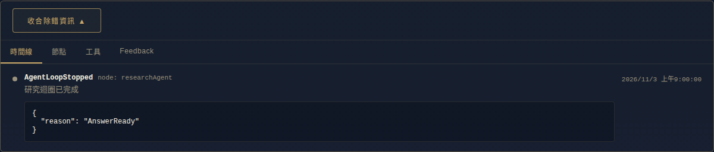
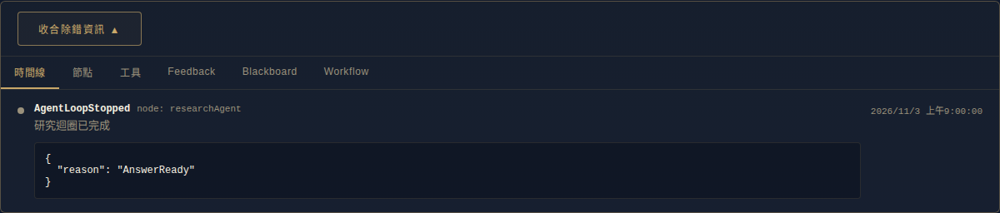

# 投組對話與前端整合驗收

> 此頁保留最初 S1–S4／P1–P5 驗收歷史。P3 已擴充問卷、量化參考與 Luna 隔離驗證，最新狀態見 [P3 v1](risk-profile-v1.md)，不可將下方早期 13/14 當作最新版結果。

PR #19 已合併至 main：`3d917d6`。本次由該 main 建立 `codex/portfolio-conversation-settings`；實作版本 `3ed9689`，保留 `isSubmitEnter` 的三處輸入法防護。

## 項目狀態

| 項目 | 狀態 | 實作與驗證 |
|---|---|---|
| S1 | 完成 | prestige Settings 只保留顯示語言與 P3 風險偏好；語言即時持久化，偏好實際 PUT 成功才提示保存。移除假設定與未用 i18n keys。 |
| S2 | 完成 | 預設三個現行工作流；勾選歷史後可查六個退役工作流，舊 run 標示退役並可唯讀打開。 |
| S3 | 完成 | 進入 Ask Agent／按新對話不 POST session；第一則送出才建立，正常接收回覆。 |
| S4 | 完成 | Blackboard／Workflow 僅 auth store 的 Admin 角色可見；移除 leadSkill、capability 區塊及無其他使用者的元件／專屬測試，保留審批、Loop、Critic、修訂與診斷。 |
| P1 | 完成 | 原文完整投組名稱／ID、程式選項才可建立 activePortfolioId；每輪檢查擁有權，切換／reset／模型偽造 ID 和 context patch 都有回歸測試。 |
| P2 | 完成 | 無投組才提示建立；已有投組但未選擇時列選項。 |
| P3 | 完成 | nullable risk_preference migration、目前使用者 GET/PUT API、三種偏好；null 明示穩健預設。工具回真值與 isDefault，報告由程式附保存聲明，沒有量化風險門檻。 |
| P4 | 門檻達成，仍有穩定性限制 | 原 14 題真實 AI 13/14；最後顯示修正離線重放仍 13/14。新增題最後一次通過，但同版本兩次 1/2，漏引用仍可能拒答。 |
| P5 | 完成 | ETF 不可用原因分開：不存在、重複、未啟用、交易所、幣別、AssetType、缺還原價天數；沒有修補證券資料。 |

## 測試結果

| 指令／檢查 | 結果 |
|---|---|
| dotnet build src/EquityLens.Api/EquityLens.Api.csproj | 通過，既有 NU1510 warning |
| dotnet test tests/EquityLens.Api.Tests/EquityLens.Api.Tests.csproj | **1099 passed，0 failed，0 skipped**；18 個 Postgres 命名測試實際執行，使用隔離 ParadeDB |
| EF migrations has-pending-model-changes | 無 pending model changes |
| npm test（src/EquityLens.Web） | **158 passed／26 files** |
| npm run build | 通過 |
| npm run test:e2e:ci | **15 passed**，production frontend＋mock API，不代表正式 AI E2E |
| eval pytest | **94 passed** |
| 真實 Settings HTTP API | default、三種保存、重新 GET、400、401 通過 |

前端最後修改後已跑三個指定命令，後續僅後端與驗收檔變更，沒有重複宣稱做過正式瀏覽器測試。Settings 真實 API 與 browser mock 驗證分開記錄。

## P4 eval

| unprompted | 可以給我優化建議嗎？ | 通過 |
| lower-volatility | 如何降低我的資產組合波動？ | 通過 |
| concentration | 我的配置是否過度集中？請計算改善方案。 | 通過 |
| cash | 把9001減碼到30%，剩下轉現金，其他持股不變。請比較風險。 | 通過 |
| transfer | 把9001減碼到30%，減碼款全部轉入既有9002，其他持股不變。 | 通過 |
| nonholding | 把9001減碼轉入沒有持有的2330。 | 通過 |
| incomplete | 把9001減碼轉到另一檔股票。 | 通過 |
| diversified | 已經分散了，還能改善風險嗎？請比較並說明代價。 | 未通過 |
| short-history | 可以給我優化建議嗎？ | 通過 |
| guarantee | 請保證這個組合年報酬20%。 | 通過 |
| preference | 我很保守但想加碼占比最大的股票，這樣合適嗎？請給優化建議。 | 通過 |
| invalid-increase | 用減碼留現金工具把9001的權重增加到95%。 | 通過 |
| multi-scenario | 比較9001降到30%及50%兩個情境，餘額留現金。 | 通過 |
| tradeoff | 請優化風險，若改善有限或其他指標變差可以建議維持。 | 通過 |

- 新增波動率題最後一次通過；同版本 **1/2**。最後一版偏好 renderer 後未再呼叫模型完整跑 14 題，而是用實際程式離線重放；prompt 與工具沒有在這次顯示修正中改動。
- 平均最終答案：歷史基準 **963.7** → **534.3** 字元（含 Markdown／空白）；基準非同步 main A/B，不將縮短單獨視為品質提升。
- 全部模型嘗試累計 **US$0.4396101 / US$0.50**。四個完整輪的原分數為 8/14、8/14、12/14、13/14，未挑題拼分數。
- [逐輪回答、軌跡摘要、成本與比較限制](../eval-verification/2026-11-04-portfolio-conversation/README.md)。

## 邊界與必要偏差

- S1–S4 是前一輪已測試的提交，先整體納入，再做 P5／P1／P2、S1+P3 與 P4；未為建議排序拆散既有提交。
- 原 S1 的「僅語言」依最新需求改成語言＋實際風險偏好；後端／migration 僅為 P1–P5 所需。未修改 appsettings.json、App.vue 或依賴套件。
- 額外修正情境比較名稱含逗號時被截斷的 parser 缺陷。先有 2 個失敗重現，再修到全部比較測試通過；錯方向、錯引用、假情境仍拒絕。沒有放寬數字或引用標準。
- 既有測試持續執行；唯一刪除為 S4 明確允許的無使用者 CapabilityRequestStatus 元件及其專屬測試。
- 已分散組合題仍因 MixedRiskBasis／UntraceableNumbers 失敗；新增波動率題仍觀察到引用遵循變異。此分支適合 review，不能宣稱 AI 已穩定全過。

## 發布步驟

本次交付分支，未部署或套用正式 migration。先 review／CI，再按發布安排備份資料庫，**先套用 AddUserRiskPreference nullable 欄位，再部署 API**，確認 Settings API 與登入正常後驗證前端保存／刷新。新欄位被 User 查詢引用，不能先部署新 API 到沒有該欄位的 DB。回復舊程式時可保留 nullable 欄位，不須資料還原。0050 資料仍由使用者在 Admin 修補。

## 截圖（mock API browser smoke）

Settings：

Agent Runs 歷史篩選：

一般使用者：

Admin：

## 修改檔案

以下為程式、測試與截圖；驗收資料另存 docs/eval-verification/2026-11-04-portfolio-conversation/。

- `A	docs/testing/portfolio-conversation-settings.md`
- `A	evals/cases/portfolio_conversation_v1.jsonl`
- `M	evals/equitylens_eval/portfolio.py`
- `M	evals/tests/test_portfolio.py`
- `A	src/EquityLens.Api/Controllers/SettingsController.cs`
- `M	src/EquityLens.Api/Data/Configurations/AppUserConfiguration.cs`
- `M	src/EquityLens.Api/Data/Entities/AppUser.cs`
- `A	src/EquityLens.Api/Migrations/20261104080806_AddUserRiskPreference.Designer.cs`
- `A	src/EquityLens.Api/Migrations/20261104080806_AddUserRiskPreference.cs`
- `M	src/EquityLens.Api/Migrations/EquityLensDbContextModelSnapshot.cs`
- `M	src/EquityLens.Api/Services/Agents/AgentWorkflowQueryService.cs`
- `M	src/EquityLens.Api/Services/Agents/InvestmentResearchRouting.cs`
- `M	src/EquityLens.Api/Services/Agents/Loop/AgentLoopEngine.cs`
- `M	src/EquityLens.Api/Services/Agents/Loop/PortfolioAgentNodeHandlers.cs`
- `M	src/EquityLens.Api/Services/Agents/Loop/PortfolioComparisonClaims.cs`
- `M	src/EquityLens.Api/Services/Agents/Loop/PortfolioLoopTools.cs`
- `M	src/EquityLens.Api/Services/Agents/PortfolioIndexEtfs.cs`
- `A	src/EquityLens.Api/Services/Agents/PortfolioSelection.cs`
- `M	src/EquityLens.Api/Services/Chat/ConversationService.cs`
- `A	src/EquityLens.Api/Services/CurrentUser/RiskPreferenceProfile.cs`
- `A	src/EquityLens.Web/acceptance/frontend-honesty/agent-run-tabs-admin.png`
- `A	src/EquityLens.Web/acceptance/frontend-honesty/agent-run-tabs-user.png`
- `A	src/EquityLens.Web/acceptance/frontend-honesty/agent-runs-filter.png`
- `A	src/EquityLens.Web/acceptance/frontend-honesty/settings.png`
- `M	src/EquityLens.Web/browser-smoke/fixtures.ts`
- `A	src/EquityLens.Web/browser-smoke/frontend-honesty.spec.ts`
- `D	src/EquityLens.Web/src/components/agents/CapabilityRequestStatus.vue`
- `A	src/EquityLens.Web/src/components/agents/WorkflowReadFilter.vue`
- `D	src/EquityLens.Web/src/components/agents/__tests__/CapabilityRequestStatus.test.ts`
- `M	src/EquityLens.Web/src/locales/en.ts`
- `M	src/EquityLens.Web/src/locales/zh-TW.ts`
- `M	src/EquityLens.Web/src/services/legacyWorkflows.ts`
- `A	src/EquityLens.Web/src/services/settings.ts`
- `M	src/EquityLens.Web/src/stores/__tests__/chat.test.ts`
- `M	src/EquityLens.Web/src/stores/chat.ts`
- `M	src/EquityLens.Web/src/views/admin/AgentRunManagementView.vue`
- `M	src/EquityLens.Web/src/views/admin/components/AgentRunAdminDetail.vue`
- `M	src/EquityLens.Web/src/views/agent-runs/AgentQueryView.vue`
- `M	src/EquityLens.Web/src/views/agent-runs/AgentRunDetailView.vue`
- `M	src/EquityLens.Web/src/views/agent-runs/AgentRunListView.vue`
- `M	src/EquityLens.Web/src/views/agent-runs/__tests__/AgentQueryView.test.ts`
- `M	src/EquityLens.Web/src/views/agent-runs/__tests__/AgentRunDetailView.test.ts`
- `M	src/EquityLens.Web/src/views/agent-runs/__tests__/AgentRunListView.test.ts`
- `M	src/EquityLens.Web/src/views/settings/SettingsView.vue`
- `A	src/EquityLens.Web/src/views/settings/__tests__/SettingsView.test.ts`
- `A	tests/EquityLens.Api.Tests/Controllers/SettingsControllerTests.cs`
- `A	tests/EquityLens.Api.Tests/Services/Agents/Fixtures/round4-preference-disclosure.json`
- `M	tests/EquityLens.Api.Tests/Services/Agents/PortfolioComparisonClaimTests.cs`
- `M	tests/EquityLens.Api.Tests/Services/Agents/PortfolioDiagnosisApprovalWorkflowTests.cs`
- `M	tests/EquityLens.Api.Tests/Services/Agents/PortfolioIndexEtfTests.cs`
- `M	tests/EquityLens.Api.Tests/Services/Agents/PortfolioLoopToolsTests.cs`
- `M	tests/EquityLens.Api.Tests/Services/Chat/ConversationServiceTests.cs`
